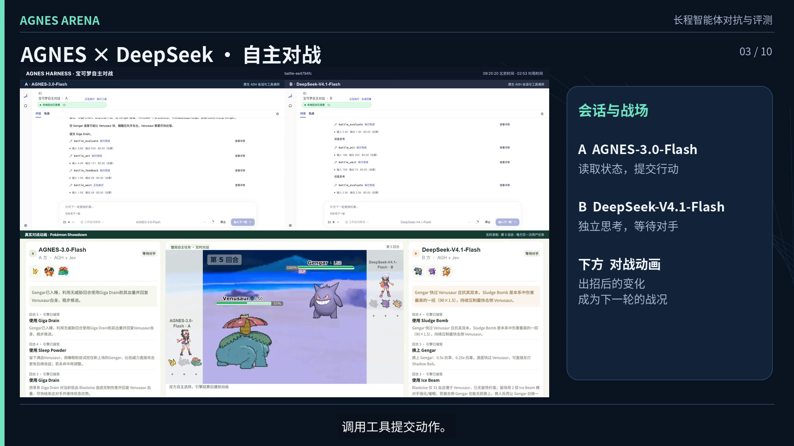
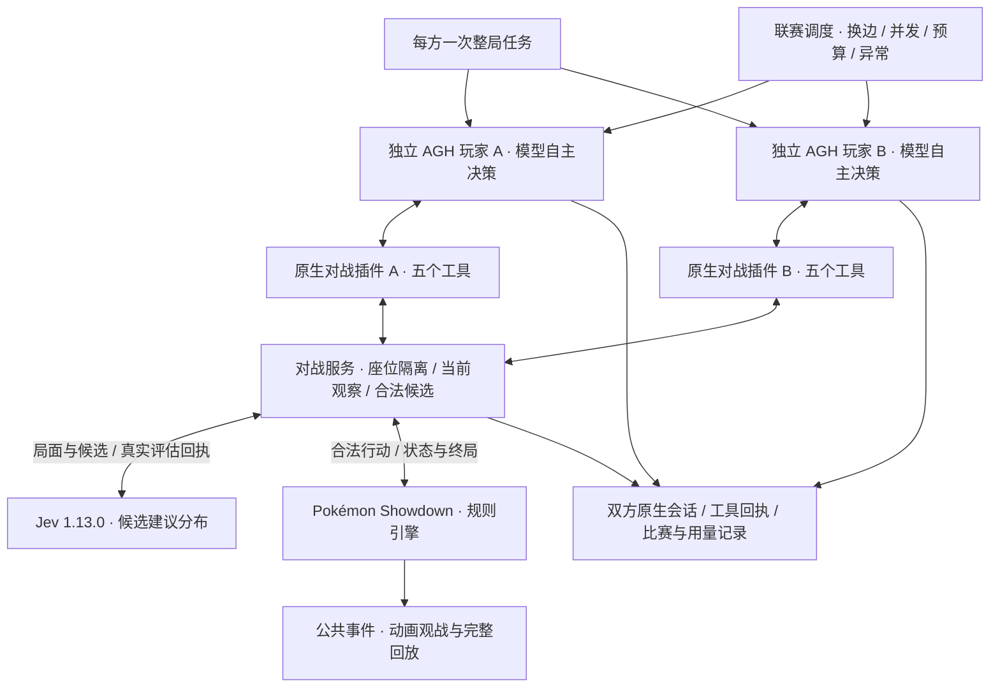
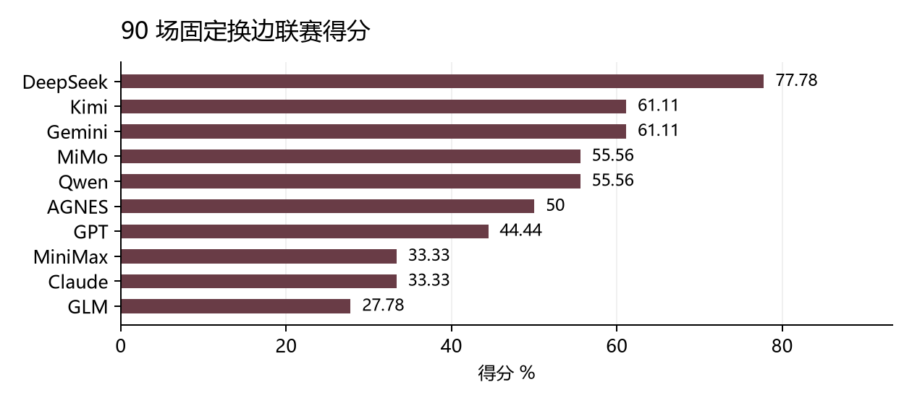

# AGNES Arena

**宝可梦对战 · 从一次指令到整局自主行动**

基于 Agnes Harness（AGH）与 Jev 的双玩家智能体对战项目。两个独立 AGH 玩家接收各自的一次整局任务，持续观察局面、评估合法候选、选择技能或换人，并根据真实反馈行动至比赛结束。系统将原生模型会话、规则引擎、动画观战、完整回放和换边联赛放在同一条可观察的执行链上。

> **“请作为 A 方完成这场对战：观察局面，参考 Jev 评估，自主选择行动，直到引擎确认比赛结束后再汇报结果。”**

[观看 / 下载完整演示](https://github.com/sevenboom77/jev_Pokemon/releases/download/v0.1.0/AGNES_Arena_demo.mp4) · [了解系统](#系统如何工作) · [联赛结果](#联赛与实验结果) · [开始复现](#开始复现) · [技术文档](docs/03-技术文档.md) · [来源与许可](#来源与许可)

2026 年江苏省 AI+科学与工程创新实践黑客松高校组参赛项目 · 东南大学 · 智能先锋 · G003

## 演示与回放

[](https://github.com/sevenboom77/jev_Pokemon/releases/download/v0.1.0/AGNES_Arena_demo.mp4)

[完整项目演示](https://github.com/sevenboom77/jev_Pokemon/releases/download/v0.1.0/AGNES_Arena_demo.mp4)约 4 分 40 秒，包含双方原生 AGH 对话、真实对战动画、九宫格比赛集合与联赛结果。上图截自随包的完整演示视频，展示保存的实验过程。

对战动画读取 Pokémon Showdown 引擎的公共事件，完整回放沿用同一份事件记录。技能、换人、状态变化、击倒与胜负来自规则引擎；播放倍速只改变展示节奏。原始会话与比赛记录可从[发布附件](https://github.com/sevenboom77/jev_Pokemon/releases)获取。

## 这个项目解决什么问题

一个模型能解释“这一回合该怎么打”，还需要进一步证明它能完成整场任务：持续读取变化的状态、调用正确工具、等待对手、处理失败，并在环境真正终止时收尾。

宝可梦对战提供了规则明确、结果直观的连续决策环境。技能、属性克制、状态和换人带来不同选择；对手的隐藏信息又限制了每个玩家能看到的内容。AGNES Arena 用两份独立 AGH 会话组织这些决策，让模型从一次任务开始持续行动，而不是由调度脚本逐回合替它选择动作。

| 能力 | 在项目中的作用 |
| --- | --- |
| 原生 AGH 长程任务 | 每方一个整局任务，连续调用工具，直到引擎终局 |
| Jev 辅助决策 | 根据当前观察与合法候选提供建议分布，玩家保留最终选择权 |
| 合法行动协议 | 用 `decisionId` 和候选 ID 将动作绑定到当前局面 |
| 座位与观察隔离 | 每方只获得己方状态和对手公开信息，不能切换身份查看另一方 |
| 事件等待与任务接续 | 状态更新唤醒等待，终止钩子避免把暂时无事可做误判为整局完成 |
| 动画与完整回放 | 将公开引擎事件还原为可观战的比赛，关联双方原生会话 |
| 换边联赛 | 固定阵容与种子，交换模型座位比较本轮配置表现 |

## 系统如何工作

**AGH 管理会话与工具执行，玩家模型选择行动，Jev 提供辅助，Showdown 负责规则与胜负。** 调度器管理比赛并发、预算和请求异常，网页展示当前战况与保存的回放。



### 五个工具串起整场比赛

`battle_observe` → `battle_evaluate` → `battle_act` → `battle_feedback` → `battle_wait`

玩家先取得自己的观察与合法候选，再参考 Jev 选择动作，核对提交结果并等待下一次决策。普通回合双方同时选择；强制换人只向相关座位发出请求。局面变化会唤醒等待，短暂超时或对手未提交都不等于比赛结束。

每次行动须对应当前 `decisionId` 和合法候选，旧决策、重复提交或越权访问会被拒绝。AGH 插件通过 `turn_stopping` 检查终局条件：比赛未结束时继续同一个任务，结束后才允许正常收尾。

### Jev 提供什么帮助

**Jev 是 TypeSafe AI 提供的结构化决策模型**，本轮使用 `jev-1.13.0`。它接收实际局面与合法候选，返回选择建议、候选分布和用量信息；分布描述候选选择倾向，不是战斗胜率。

调用链为 `battle_evaluate → 对战服务 → Jev HTTP 客户端`。多个合法候选时，带 Jev 的比赛要求取得真实评估回执后再提交动作；只有一个合法动作时无需评估。同一决策复用已取得的回执，避免重复调用。玩家可以结合局面选择候选，最终行动不由 Jev 自动代替。

## 联赛与实验结果



图为本轮固定条件下的联赛得分。

本轮在第九世代自定义单打中比较 **10 个玩家模型请求配置**，双方各使用 3 只、等级 50 的固定宝可梦。每一对模型打两场，第二场交换模型座位，使每个模型都有使用两套阵容的机会。所有玩家共同使用 Jev 1.13.0。

| 项目 | 原实验记录 |
| --- | --- |
| 玩家模型配置 | **10** 个 |
| 完整换边配对 | **45** 组 |
| 有效比赛 | **90** 场，每个模型 **18** 场 |
| 完整原生 AGH 任务 | **180** 份，每场双方各一份 |
| 有效会话事件 | **185,020** 条 |
| 有效会话工具调用 | **9,681** 次 |
| 有效组 Jev 调用 | **2,244** 次 |
| 全部比赛尝试 | **282** 次，保留失败、取消与补跑 |
| 原交付无付费测试 | **75** 项对战测试 + **10** 项 Jev 客户端测试 |

计分选取**最早通过核验的完整两场换边组**，不根据胜负挑选重试结果，也不把技术取消记成对战败局。有效比赛同时核对引擎终局和双方 AGH 任务完成，完整记录用于区分任务执行能力、策略选择与服务异常。

本轮记录中，DeepSeek-V4.1-Flash 配置为 **14 胜 4 负**；AGNES-3.0-Flash 为 **9 胜 9 负**，均完成 18 场计分对局。完整榜单、请求名与计分方法见[评测报告](docs/04-评测报告.md)。这些是固定阵容、种子和服务配置下的有限样本，不作为通用模型能力排名。

当前实验研究“共同 Jev 辅助下的长程执行与对战表现”。**不带 Jev 的联赛消融尚未运行**，因此还不能把胜负或完成能力直接归因于 Jev。下一步将固定配对、阵容、种子、提示与预算，比较有无辅助时的动作、完成率、回合数、耗时与成本。

## 开始复现

### 第一步：观看演示，阅读已有对局

[完整视频](https://github.com/sevenboom77/jev_Pokemon/releases/download/v0.1.0/AGNES_Arena_demo.mp4)、[作品说明](docs/01-作品说明.md)、[技术文档](docs/03-技术文档.md)和[评测报告](docs/04-评测报告.md)可以直接阅读，无需模型授权。完整会话与大量运行记录通过[发布附件](https://github.com/sevenboom77/jev_Pokemon/releases)提供，下载后从相对阅读索引选择具体比赛。

### 第二步：安装与无付费测试

原执行及交付验证平台为 **macOS，Node.js 24.10–24.x**；记录中的 Node.js 为 24.21.0，AGH 工作区使用 **pnpm 10.34.5**。仓库保留并列的 `pokemon/` 对战工程与 `agnes-harness/` 固定框架源码。

```bash
git clone https://github.com/sevenboom77/jev_Pokemon.git
cd jev_Pokemon
ARENA_ROOT="$(pwd -P)"

cd "$ARENA_ROOT/agnes-harness"
pnpm install --frozen-lockfile
cd "$ARENA_ROOT/pokemon"
npm ci --ignore-scripts
npm run battle:build
npm run battle:test
npm run jev:test
```

构建使用随附的固定 Showdown Client 源码。测试使用规则引擎与受控本地响应，不启动付费模型比赛。本次公开整理在 **Windows + Node.js 24.19.0** 完成动画构建，**75 项对战测试和 10 项 Jev 客户端测试全部通过**。这组测试不代表真实模型比赛已在 Windows 完整验证；测试打包适配见[发布说明](docs/PUBLICATION_NOTES.md)。若只想先运行无需第三方依赖的客户端最小验证，可进入 `pokemon/` 执行 `npm run jev:test`。

### 第三步：准备 AGH 与自己的服务配置

从固定源码构建本机 AGH 运行产物：

```bash
cd "$ARENA_ROOT/agnes-harness"
pnpm --filter @agnes/cli build:local
export AGH_AGNES="$ARENA_ROOT/agnes-harness/packages/cli/dist/local/agnes.mjs"
node "$AGH_AGNES" --help
cd "$ARENA_ROOT/pokemon"
cp .env.example .env
```

填写自己的 AGNES 接口、模型网关与 `TYPESAFE_API_KEY`。`models.example.json` 保留本轮请求配置；使用时需要对应服务支持这些别名。原联赛包含传输、历史恢复与超时适配，跨平台构建及初始化需要单独核对，详见 [SOURCE_INSTALL.md](SOURCE_INSTALL.md) 和[复现说明](docs/02-复现说明.md)。

### 第四步：启动一场真实对战

以下操作会使用自己的玩家模型和 Jev 服务额度：

```bash
cd "$ARENA_ROOT/pokemon"
npm run battle:build
npm run battle:live
```

服务就绪后，在 `pokemon/` 目录分别打开两个终端：

```bash
node --env-file=.env scripts/battle-web.mjs A
```

```bash
node --env-file=.env scripts/battle-web.mjs B
```

使用随附 `.env.example` 时，访问 `http://127.0.0.1:18795/`，选择 A/B 模型，保留 Jev 选项并开始比赛。使用随附 `.env.example` 时，双方原生工作台端口为 `18781`、`18782`，新对局保存到 `pokemon/runs/`。这一步启动单场演示，不会自动发起 90 场联赛。

动画需通过本地 HTTP 服务访问，部分精灵、背景与声音依赖 Showdown 在线素材。新比赛受模型随机性与第三方服务状态影响，不保证产生与原实验相同的胜者。

## 源码导航

| 路径 | 从这里了解什么 |
| --- | --- |
| [pokemon/packages/agh-battle-plugin](pokemon/packages/agh-battle-plugin/) | 五个原生 AGH 工具与终止钩子 |
| [pokemon/packages/battle-arena](pokemon/packages/battle-arena/) | 状态、规则、合法候选、整局任务与联赛调度 |
| [pokemon/packages/jev-client](pokemon/packages/jev-client/) | Jev 接口、候选与回执校验、受控测试 |
| [pokemon/packages/battle-web](pokemon/packages/battle-web/) | 动画观战、玩家入口与回放展示 |
| [pokemon/scripts](pokemon/scripts/) | 构建、启动、传输适配与历史恢复 |
| [pokemon/vendor/showdown-client](pokemon/vendor/showdown-client/) | 固定版本的 Showdown 动画客户端 |
| [agnes-harness](agnes-harness/) | 固定 AGH 源码及原许可 |
| [docs](docs/) | 项目说明、技术文档、复现说明与评测报告 |
| [发布附件](https://github.com/sevenboom77/jev_Pokemon/releases) | 报告、演示材料与完整运行记录 |

## 来源与许可

- 基于 **Agnes Harness**，保留其 [Apache-2.0 许可证](agnes-harness/LICENSE)与 [NOTICE](agnes-harness/NOTICE)。
- 对战规则由 **Pokémon Showdown 0.11.10** 的本地 BattleStream 执行；动画使用固定版本 **Pokémon Showdown Client**，其[原许可证](pokemon/vendor/showdown-client/LICENSE)与来源文件保留在对应目录。
- **Jev 1.13.0** 由 TypeSafe AI 服务提供，调用遵循服务方接口与账户条款。参赛模型名称及请求映射按本轮记录说明，不将网关别名等同于独立核实的底层权重身份。
- Pokémon 角色、名称及相关素材的权利归各自权利人；本仓库不为第三方游戏素材授予新的使用许可。其余组件遵循各自许可。
- 上游来源及当前公开整理范围见 [UPSTREAM.md](UPSTREAM.md) 和 [发布说明](docs/PUBLICATION_NOTES.md)。
- 仓库保留现有组件的版权与许可，不统一改写为 MIT；公开源码不代表全部代码、数据、素材和服务采用同一种许可。

下一步将扩展预先固定的阵容与配对种子，完成 Jev 消融，并完善失败恢复与跨平台复现，让“能看见一局对战”进一步成为“能研究一整段智能体执行过程”。
