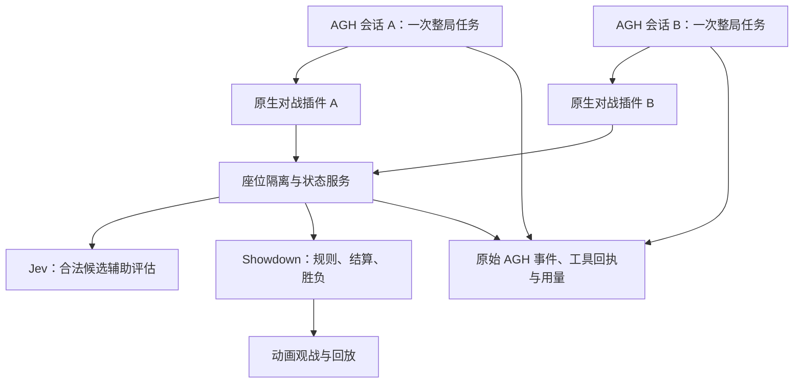

> 公开目录名已更新。当前安装入口以根目录 SOURCE_INSTALL.md 为准；原实验平台与结果说明保留。

# AGNES Arena 技术文档

## 1. 实现形式：原生 AGH 插件与对战服务

系统由三部分组成：原生 AGH 后端插件、独立对战服务、动画与证据展示页面。插件包 `@pokemon/agh-battle-plugin` 使用 `agnes.plugins` 声明，通过 `extension.registerTool` 注册五个工具，并通过 `turn_stopping` 钩子核对整局是否结束。

AGH 负责会话、模型调用、工具执行和长程任务生命周期；对战服务负责座位身份、状态同步和规则引擎；网页只展示比赛。项目使用电子游戏的技能与换人规则，早期卡牌工程不属于本次交付路径。



[查看系统架构图](系统架构.svg)

## 2. 每方只有一个整局任务

runner 为 A/B 各创建一个独立会话、绑定比赛与模型，然后各发送一次完整用户任务。模型自行重复以下流程，直至环境终止：

1. `battle_observe`：读取自己一侧的观察和当前合法候选。
2. `battle_evaluate`：有多个候选时取得本次决策的真实 Jev 辅助回执。
3. `battle_act`：选择一个候选并提交简短中文理由。
4. `battle_feedback`：检查提交是否被接受。
5. `battle_wait`：等待下一次决策或引擎终局。

普通回合双方同时选择，强制换人时只向相关座位发出请求。等待由事件驱动，局面变化会立即唤醒；无变化时最多等待 45 秒。等待超时、暂停或对手尚未提交，不构成任务结束。

插件的 `turn_stopping` 钩子只检查终局条件。环境未结束时让同一个 AGH 任务继续；环境已结束时允许收尾。运行时生成的 `kind=runtime_context` 提示与真正的用户任务分别计数。监督器管理预算与健康状态，不逐回合观察局面后给模型补发决策。

## 3. 工具与状态接口

| 工具 | 输入要点 | 返回与约束 |
| --- | --- | --- |
| `battle_observe` | `matchId` | 自己的完整局面、对手公开信息、合法候选、`decisionId` |
| `battle_evaluate` | `matchId, decisionId` | Jev 的真实建议与用量；每个决策缓存一次 |
| `battle_act` | 上述身份、`candidateId, explanation` | 合法性检查和接受回执 |
| `battle_feedback` | 比赛与决策编号 | 核对已提交动作；接受可能仍在等待另一方 |
| `battle_wait` | 比赛、上次决策编号 | 下一观察、等待超时或已结束状态 |

每个新请求都有决策编号，提交必须对应当前观察中的候选。旧决策、非法候选、重复提交以及跨比赛访问被拒绝。Jev 组中多个合法候选尚无成功评估回执时，动作提交被拒绝。

座位由服务令牌与会话工作目录绑定，不能由模型参数切换。观察不包含对手隐藏技能、私有数值或未结算选择。玩家只获得五个对战工具，通用文件、shell、浏览器与子任务工具被禁用；Jev 密钥只留在服务端。

## 4. Jev 是什么，如何调用

Jev 是 TypeSafe AI 的结构化决策模型。系统提供当前观察与合法候选，要求它从候选集合中给出建议；概率表示候选选择分布，不是战斗胜率。

调用链为 `AGH battle_evaluate → 对战服务 evaluateOnce → Jev HTTP 客户端`。本轮固定版本 `jev-1.13.0`，接口如下：

```http
POST https://api.typesafe.ai/v1/systemone
Authorization: Bearer <TYPESAFE_API_KEY>
Content-Type: application/json
```

```json
{
  "model": "jev-1.13.0",
  "state": {"当前局面": "由 battle_observe 提供的实际观察"},
  "questions": {
    "action": {
      "type": "choice",
      "instructions": "比较合法动作，评估换人损失的当前攻击机会与后续收益",
      "criteria": {"候选ID": "该合法候选的结构化说明"}
    }
  }
}
```

上例是接口结构说明，真实请求直接使用观察对象和候选列表。返回 `answers.action.choice`、`probabilities`、`confidence` 与用量。服务校验模型版本、合法选项和成功回执，然后返回给玩家；玩家保留最终决策权。只有一个合法动作时无需评估；同一决策重复请求复用真实回执，避免重复收费。

协议来源：[TypeSafe Quick start](https://docs.typesafe.ai/introduction/quickstart)、[Choice](https://docs.typesafe.ai/primitives/choice)。

## 5. 换人策略与公平比较

主动换人会占用本回合的攻击、恢复或强化机会，换入者可能立即受到攻击。提示与候选元信息显式标出 `switchReason`、`spendsTurn`、`recentOwnActions` 和立即换回标记，要求模型比较留场与换人的具体收益。技能触发换人及倒下替补与主动换人分别处理。

这项改动帮助模型认识换人的机会成本，同时保持合法规则；没有通过禁止换人或本地规则代替模型行动。

联赛使用固定队伍和种子，同一配对打两场并交换模型座位。计分选择最早有效的完整换边组，保留不计分尝试，避免只选单场成功或胜者。

## 6. 规则引擎与动画

规则引擎使用 `pokemon-showdown@0.11.10` 的本地 BattleStream。双方私有流生成各自观察，观众流产生公共事件。技能伤害、状态、属性克制、换人、击倒与胜负均由引擎结算。达到 40 回合仍无胜者时由引擎发出平局结果。

动画模块来自 Pokémon Showdown Client 固定提交 `c0f6bfc707a5e3bba4da3785e9cb06c8ae04f8d9`。自建页面将公共事件传入其动画组件，显示精灵、技能、换人与状态。精灵、背景及部分声音依赖 Showdown 在线素材；界面不能直接以 `file://` 打开，需通过本地服务访问。

回放直接读取已保存的引擎公共事件。播放倍速改变展示节奏，不改比赛决策与结果。视频中的九宫格展示已有比赛，各局结束后停留在终局画面。

## 7. 并发、传输与异常处理

比赛调度与请求限流分别控制：比赛队列设置同时比赛数量；模型与 Jev 请求池管理各渠道的调用并发。429 与暂时性网络错误采用有界退避和隔离；单个模型不可用不会自动替换模型或渠道，也不会把技术取消算作对战败局。

本地传输适配保留上游真实推理块、签名、模型名、结束原因与用量；仅在对应内容、工具参数或真实压缩摘要可匹配时回填。遇到无法匹配的历史或缺少终止事件的响应，记录失败，不猜测缺失输出。已输出内容后的网络中断不能静默重发整次生成。

联赛还保留恢复补丁：历史上被拒绝的非法工具调用，只有在同一比赛和决策中出现后来可信、合法且成功的真实替代调用时，才能被任务完成检查认定已恢复。原始事件不被改写，也不执行旧的非法调用。

## 8. 完成核验与记录

一个计分对局须同时满足引擎终局、双方正常完成、每方一个整局用户任务、一次任务启动、连续事件序号及对应的真实 Jev 回执。HTTP 200 或动画结束都不足以单独证明任务完成。

每场保存 `battle.json`、`agh-a.jsonl`、`agh-b.jsonl`、逐调用用量与网关尝试记录。异常原生响应在诊断启用后保留原文；较早缺失原文的响应按缺失保留。已核验 90 场、180 份会话，全部 282 次尝试仍可追溯。

## 9. 源码位置

| 功能 | 交付源码路径（相对 `pokemon`） |
| --- | --- |
| 原生插件与终止钩子 | `packages/agh-battle-plugin/index.mjs` |
| 状态、规则、合法候选与 Jev | `packages/battle-arena/match.mjs` |
| 单次整局任务与历史验收 | `packages/battle-arena/runner.mjs` |
| 并发调度 | `packages/battle-arena/scheduler.mjs` |
| 请求池、SSE 与重试 | `packages/battle-arena/request-pool.mjs` |
| 网关传输适配 | `packages/battle-arena/deepseek-transport.mjs` |
| 换人机会成本提示 | `packages/battle-arena/strategy.mjs` |
| Jev API | `packages/jev-client/index.mjs` |
| 动画页面 | `packages/battle-web/` |
| 历史恢复与超时补丁 | `scripts/battle-runtime-recovery.mjs` |

## 附录：展示名称与请求名

| 展示名称 | API 请求名 | 接口 |
| --- | --- | --- |
| AGNES-3.0-Flash | `agnes-3.0-flash` | `openai-completions` |
| DeepSeek-V4.1-Flash | `deepseek-flash` | `anthropic-messages` |
| GLM-5.3 | `glm-5.3` | `openai-completions` |
| Kimi-K3 | `kimi-k3` | `openai-completions` |
| MiMo-V2.6-Pro | `mimo-v2.6-pro` | `anthropic-messages` |
| MiniMax-M3 | `minimax-m3` | `anthropic-messages` |
| Qwen3.8-Max-0902 | `qwen3.8-max-0902` | `openai-completions` |
| Gemini-3.8-Flash-High | `gemini-3.8-flash-high` | `anthropic-messages` |
| GPT-5.6-Terra | `gpt-5.6-terra-bingxing` | `anthropic-messages` |
| Claude-Opus-4.8 | `claude-opus-4-8` | `anthropic-messages` |

原始请求名仅用于准确复现与核对回执。展示页面、榜单与视频统一使用展示名称。
